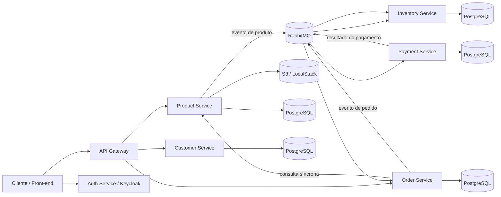

# Saga E-Commerce — Microsserviços com SAGA Coreografada

Projeto de estudo e portfólio que explora a construção de um sistema de e-commerce distribuído, com serviços desenvolvidos em **Java 21 e Spring Boot**, comunicação assíncrona com **RabbitMQ** e coordenação de processos distribuídos usando o padrão **SAGA Coreografada**.

O objetivo é demonstrar decisões comuns em sistemas distribuídos: separação de responsabilidades por domínio, persistência isolada, integração entre serviços, autenticação, processamento de pagamentos e observabilidade.

> **Status:** projeto em desenvolvimento. As funcionalidades e os procedimentos de execução devem ser conferidos conforme a evolução do código.

## Visão geral da arquitetura

O repositório reúne os serviços de back-end e arquivos de infraestrutura. A interface React/TypeScript é desenvolvida separadamente e não está incluída neste repositório.



### Serviços

| Componente | Responsabilidade |
|---|---|
| `api-gateway` | Ponto de entrada para as APIs do sistema. |
| `auth-service` | Componente de autenticação e integração com Keycloak. |
| `customer-service` | Gerenciamento dos dados de clientes. |
| `product-service` | Catálogo de produtos e gerenciamento de imagens. |
| `order-service` | Criação e acompanhamento de pedidos. |
| `inventory-service` | Controle de estoque e processamento de eventos relacionados a pedidos. |
| `payment-service` | Processamento do fluxo de pagamento e integração com Stripe em ambiente de testes. |

## Fluxo de negócio: SAGA Coreografada

A SAGA coordena uma operação de negócio por meio de eventos entre serviços, sem depender de uma única transação de banco de dados envolvendo todos eles.

1. O cliente inicia um pedido pelo fluxo de compra.
2. O `order-service` valida os dados necessários e registra o pedido.
3. O pedido gera um evento publicado no RabbitMQ.
4. Os serviços de estoque e pagamento reagem aos eventos relevantes para executar suas etapas.
5. Se uma etapa falhar após uma alteração anterior, o fluxo pode acionar uma ação compensatória — por exemplo, devolver ao estoque uma quantidade reservada.
6. O estado final do pedido é atualizado conforme os eventos processados.

A sequência exata depende dos eventos e das regras implementadas nos serviços. O padrão SAGA favorece consistência eventual; ele não equivale a uma transação ACID única entre todos os bancos.

## Tecnologias

- **Back-end:** Java 21, Spring Boot 4, Spring Data JPA, Hibernate
- **APIs e integração:** Spring Web, Spring Cloud/OpenFeign, API Gateway
- **Mensageria:** RabbitMQ, Spring AMQP
- **Banco de dados:** PostgreSQL, com bancos separados por serviço
- **Autenticação:** Keycloak, OAuth 2.0 / JWT
- **Armazenamento de imagens:** AWS SDK for Java 2.x, Amazon S3 e LocalStack para desenvolvimento local
- **Pagamentos:** Stripe API em ambiente de testes
- **Observabilidade:** Spring Actuator, Micrometer, Prometheus e Grafana
- **Ambiente local:** Docker Compose
- **Teste de carga:** k6 (script experimental no repositório)

## Organização do repositório

```text
.
├── api-gateway/
├── auth-service/
├── customer-service/
├── product-service/
├── inventory-service/
├── order-service/
├── payment-service/
├── docker-compose.yml
├── prometheus.yml
├── tempo-config.yaml
├── init-s3.sh
└── load-test.js
```

## Executar a infraestrutura local

### Pré-requisitos

- Git
- Docker e Docker Compose
- JDK 21 e Maven para executar os serviços Java
- Credenciais/configuração de desenvolvimento para os serviços externos utilizados, quando aplicável

### 1. Clonar o repositório

```bash
git clone https://github.com/nynaromanoff/saga-ecommerce.git
cd saga-ecommerce
```

### 2. Configurar as variáveis de ambiente

O arquivo `docker-compose.yml` utiliza variáveis como `POSTGRES_PASSWORD`, `KEYCLOAK_PASSWORD` e `LOCALSTACK_AUTH_TOKEN`. Configure os valores no ambiente ou em um arquivo `.env` local antes de iniciar os containers. **Não publique senhas, tokens ou chaves reais no GitHub.**

### 3. Subir os containers de infraestrutura

```bash
docker compose up -d
```

Esse comando inicia os componentes de infraestrutura definidos no Compose, como RabbitMQ, PostgreSQL, Keycloak, LocalStack, Prometheus e Grafana. Ele **não substitui a inicialização dos microsserviços Java**; cada aplicação também precisa de sua configuração e execução.

### Endereços locais da infraestrutura

| Componente | Endereço |
|---|---|
| RabbitMQ Management | http://localhost:15672 |
| Keycloak | http://localhost:8081 |
| Prometheus | http://localhost:9090 |
| Grafana | http://localhost:3000 |
| LocalStack | http://localhost:4566 |

As portas e credenciais podem variar conforme a configuração local. Altere senhas padrão antes de qualquer uso fora de um ambiente local descartável.

## Observabilidade

O projeto inclui configuração para coleta de métricas com Prometheus e visualização de dashboards no Grafana. A imagem abaixo registra um exemplo de painel existente no projeto.


## Teste de carga

O arquivo `load-test.js` contém um cenário experimental com k6. Antes de executar, confira a URL de destino, a porta correta do serviço de pedidos, os requisitos de autenticação e se o SKU usado no payload existe no ambiente. O script atual deve ser tratado como ponto de partida, não como evidência de um benchmark validado.

## Próximas melhorias

- Documentar e validar a inicialização completa de todos os serviços.
- Adicionar exemplos de configuração sem credenciais e exemplos de requisições.
- Ampliar a cobertura de testes automatizados dos fluxos de sucesso e compensação da SAGA.
- Validar o cenário k6 e registrar resultados reproduzíveis.
- Documentar a integração com o front-end React/TypeScript e incluir capturas de tela do fluxo de compra.

## Objetivos de aprendizado

Este projeto é desenvolvido para praticar e demonstrar:

- desenvolvimento de APIs com Java e Spring Boot;
- separação de responsabilidades em microsserviços;
- comunicação assíncrona orientada a eventos;
- consistência eventual e ações compensatórias com SAGA;
- persistência isolada por domínio;
- autenticação, integração com pagamentos e observabilidade.

---

**Autora:** [Jessica Santos](https://github.com/nynaromanoff)  
**LinkedIn:** [Perfil profissional](https://www.linkedin.com/in/jessica-dos-santos-9b863a12a/)
